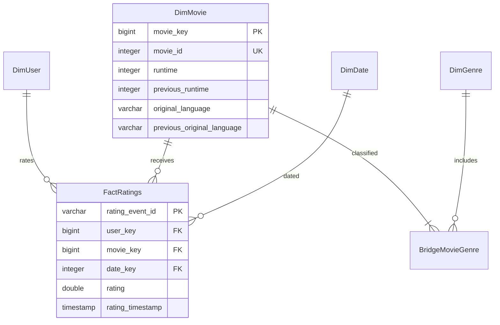

# Dimensional schema

Grain: one rating event per MovieLens user/movie/original UTC epoch. SHA-256 of colon-separated IDs and epoch is a stable technical degenerate dimension; it is not an original transaction ID. User, movie and genre sequences are persistent surrogate mappings with unique natural keys. Dates use YYYYMMDD. Users include valid rating and tag participants; no demographics are invented. Tags are retained in staging, without an unused tag warehouse fact.

The canonical bridge uses distinct MovieLens genres; unknown genres receive `Unknown`. Allocation weights sum to one per movie. Q2 uses allocated counts and weighted rating sums; Q3–Q5 use overlapping genre membership. Year always means rating year unless named release_year. Q4 is a conditional-aggregation pivot with first/last selected year mean and support columns.

Movie metadata preserves MovieLens title/year/genre and separate TMDB fields. Type 3 runtime and language retain just the immediately previous observed value. First enrichment leaves previous values null; unchanged snapshots do not shift them; one-field changes leave the other field's history intact; failed fetches do not erase existing data. Change times are observed fetch times, not historical truth. Raw envelopes provide provenance, not historical point-in-time correctness.

DDL is `warehouse/schema.sql`; SQL integrity checks run before publication. ETLRun records successful warehouse updates, while JSON run records also capture failures. Optional `TMDBFetchStatus` is not duplicated into SQL: the atomic manifest is authoritative.
