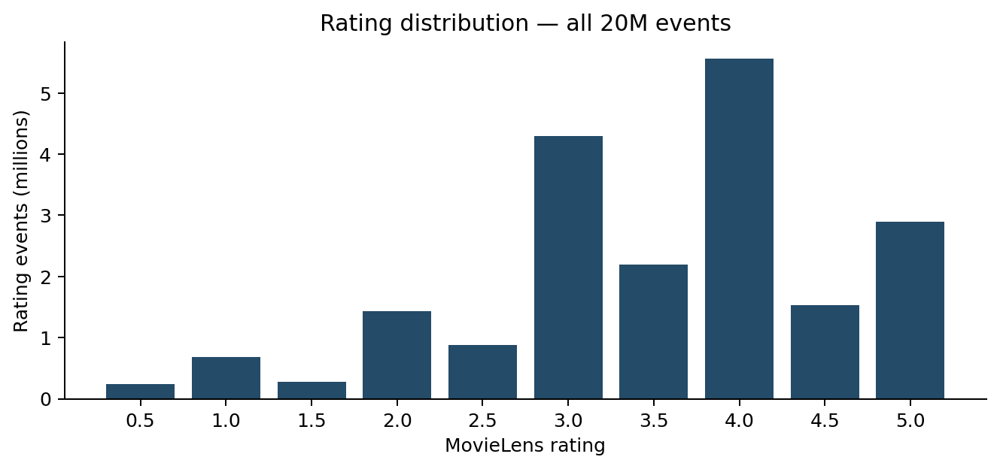
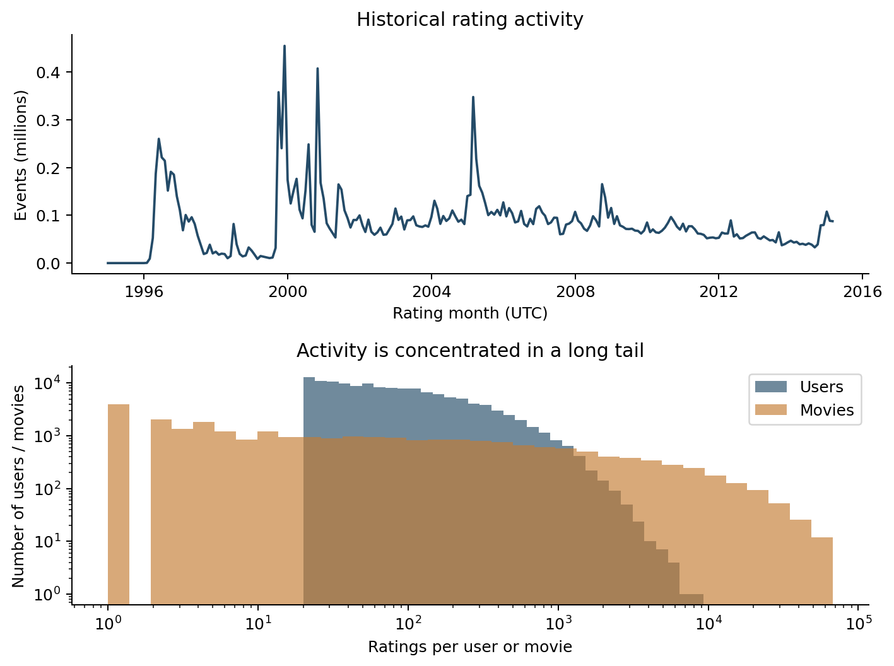
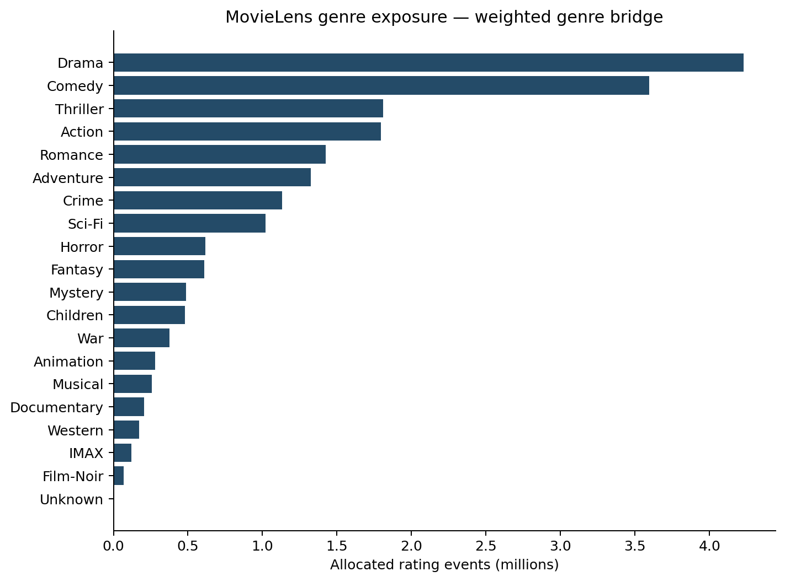
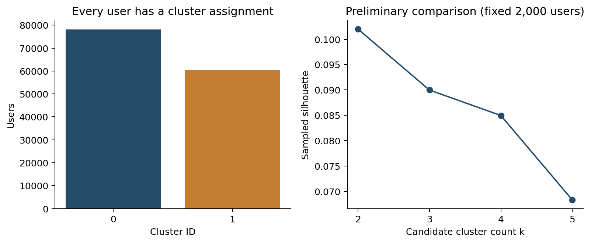
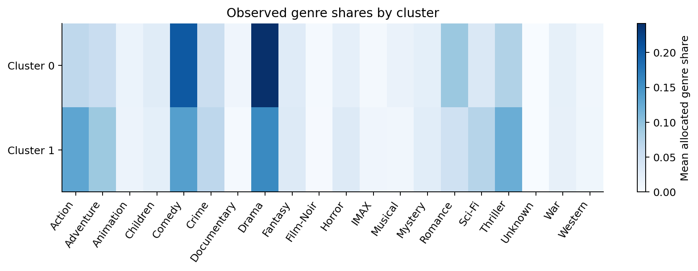
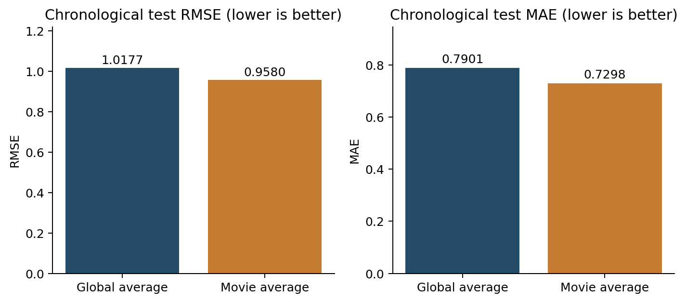

# Preliminary mining pipeline and exploratory data analysis

Analysis used the current published MovieLens 20M DuckDB warehouse: 20,000,263 rating events, 138,493 rating-active users and 26,744 rated movies (27,278 catalog entries). No rating events or fitting users were sampled. The warehouse was read-only; summaries used for this run reconciled before and after analysis. Source ETL run: `airflow-7ad6db2270f8de79ba22`.

## Preparation and EDA

Ratings span 1995-01-09 11:46:44 to 2015-03-31 06:40:02 UTC. The mean is 3.5255, and the most frequent score is 4.0. Median activity is 68 ratings per user and 18 per rated movie; the 90th percentiles are 334 and 1306, respectively. These are recorded ratings, not verified movie views.

Rating distributions, monthly activity and long-tail user/movie activity were aggregated from every fact row. Multi-genre movies were handled using the warehouse bridge allocation weight; allocated genre counts reconcile to the total event count. Numeric rating imputation was unnecessary for the validated fact table. Absent observed user/genre exposure was encoded as zero exposure, without asserting dislike.

## H2: preliminary user clustering

One feature row was produced for each of 138,493 users. The 25 features are log(1 + rating count), mean rating, population rating standard deviation, share of scores at least 4.0, log(1 + activity-span days), and fractional rating shares across MovieLens genres. StandardScaler standardized the descriptors. There were no missing/non-finite feature values. Identifiers, current TMDb popularity/votes, and unavailable tag/genome features were excluded.

MiniBatchKMeans was fitted to all users for k=2,3,4,5 (seed 42, batch size 4,096, 10 initializations, maximum 100 iterations). The silhouette score uses the same seeded 2,000-user metric subset for each candidate because exact pairwise evaluation on every user is costly. All users remain fitted and assigned; Davies–Bouldin, Calinski–Harabasz and seed-stability ARI are computed on all users.

| k | Silhouette (2,000 users) | Davies–Bouldin ↓ | Calinski–Harabasz ↑ | Seed ARI | Fit seconds |
|---:|---:|---:|---:|---:|---:|
| 2 | 0.1020 | 2.7988 | 14230.5 | 0.4049 | 0.03 |
| 3 | 0.0900 | 2.5515 | 12440.5 | 0.3626 | 0.03 |
| 4 | 0.0850 | 2.5853 | 10997.2 | 0.3347 | 0.03 |
| 5 | 0.0683 | 2.2697 | 10434.5 | 0.4657 | 0.06 |

The preliminary selection is k=2 using the highest sampled silhouette (0.1020). This comparison is exploratory. A silhouette near zero indicates overlapping groups; seed ARI measures consistency across initializations rather than correctness.

| Cluster | Users | Mean ratings/user | Mean score | Mean rating SD | Share ≥4 | Largest allocated genre shares |
|---:|---:|---:|---:|---:|---:|---|
| 0 | 78,148 | 169.6 | 3.607 | 0.962 | 54.7% | Drama 24.2%; Comedy 20.4%; Romance 9.2% |
| 1 | 60,345 | 111.8 | 3.653 | 0.920 | 55.3% | Drama 15.8%; Comedy 13.6%; Action 12.9% |

Cluster IDs have no inherent order or demographic meaning. Profiles describe behavior in this observed dataset; the preliminary analysis does not establish causal or universal preference groups.

## H3: chronological rating baselines

All rating events were divided by timestamp using the 70th and 85th percentile boundaries. Training uses timestamps strictly before 2007-12-08 01:20:38 UTC; validation uses that boundary up to 2010-12-06 22:25:11 UTC; test uses timestamps at or after the latter. Equal timestamps stay together. Splitting preceded computation of all prediction statistics.

| Partition | Ratings | First rating UTC | Last rating UTC |
|---|---:|---|---|
| train | 14,000,184 | 1995-01-09 11:46:44 | 2007-12-08 01:20:29 |
| validation | 3,000,039 | 2007-12-08 01:20:38 | 2010-12-06 22:24:33 |
| test | 3,000,040 | 2010-12-06 22:25:11 | 2015-03-31 06:40:02 |

The global baseline predicts the training mean (3.5110) for every held-out event. The movie baseline predicts a movie's training-period mean and falls back to the training global mean for unseen movies. No held-out rating contributed to training statistics.

| Partition | Baseline | Events | RMSE ↓ | MAE ↓ | Unseen-movie fallback events |
|---|---|---:|---:|---:|---:|
| validation | global_average | 3,000,039 | 1.0175 | 0.7828 | all events use global mean |
| validation | movie_average | 3,000,039 | 0.9374 | 0.7122 | 410,522 |
| test | global_average | 3,000,040 | 1.0177 | 0.7901 | all events use global mean |
| test | movie_average | 3,000,040 | 0.9580 | 0.7298 | 834,011 |

The movie-average baseline has lower test RMSE than the global baseline on this split. These results establish reference performance; H3 has not yet been confirmed because a supervised feature model has not been evaluated against them.

## Feature strategy and limitations

The next H3 model should use user-history means/counts and movie-history statistics computed from information available before each prediction, plus MovieLens genre descriptors. Training-row features must exclude their own targets and later labels. Full-history H2 summaries must not be reused as predictive features. Current TMDb ratings, vote counts and popularity are not temporally aligned to the 1995–2015 MovieLens targets and were excluded. Tags and genome scores are not loaded into this project's active rating warehouse, so their contribution remains future work.

Reproducibility: Python 3.11.11, DuckDB 1.4.4, scikit-learn 1.6.1, platform `Linux-6.12.76-linuxkit-aarch64-with-glibc2.36`, seed 42, one DuckDB thread and a 2 GB SQL memory budget. Run ID `20261012T105513014787Z`. The notebook, CSV tables, features/model files, package versions and source-code fingerprint accompany this section. Metrics are descriptive/preliminary; no final predictive-model or production recommendation claim is made.

## Method references

- GroupLens: https://grouplens.org/datasets/movielens/20m/
- MiniBatchKMeans: https://scikit-learn.org/1.6/modules/generated/sklearn.cluster.MiniBatchKMeans.html
- Silhouette score: https://scikit-learn.org/1.6/modules/generated/sklearn.metrics.silhouette_score.html
- StandardScaler: https://scikit-learn.org/1.6/modules/generated/sklearn.preprocessing.StandardScaler.html
