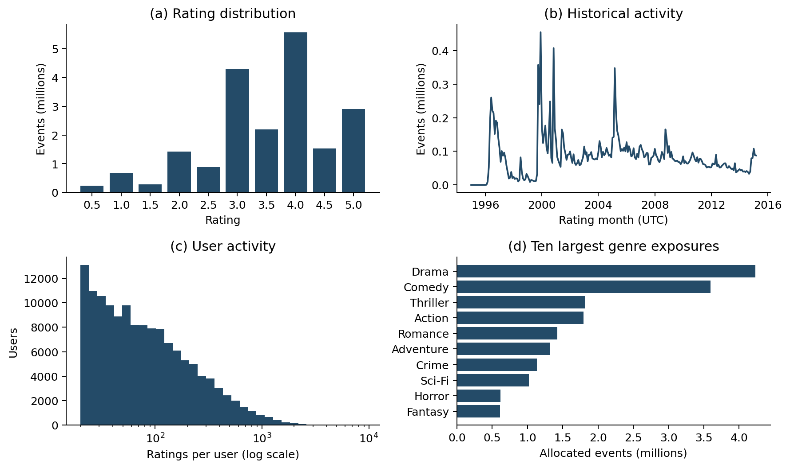
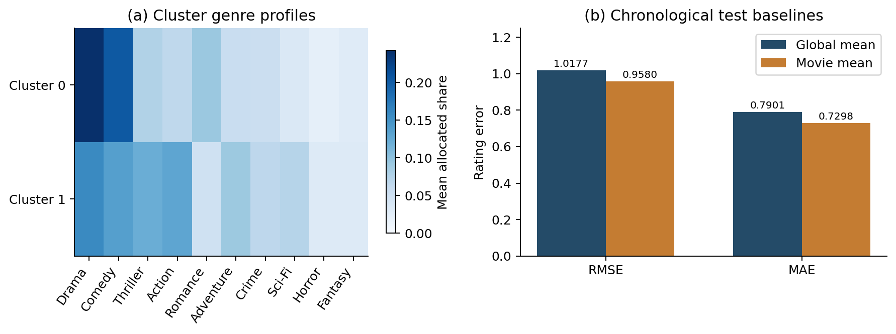

# Preliminary mining and exploratory data analysis

## Data preparation and EDA

The analysis read the current DuckDB warehouse containing **20,000,263 MovieLens rating events**, **138,493 rating-active users** and **26,744 rated movies** (27,278 metadata records). All events were used; clustering received the complete user feature table. The warehouse was mounted/read-only and its count/sum summary remained unchanged. Tags/genome are not part of this active warehouse; current TMDb rating and popularity measures were excluded from historic prediction.

Ratings cover 1995–2015 UTC. The mean score was **3.5255** and the most common score was **4.0**. Median activity was **68 ratings per user** and **18 per rated movie**. Numeric rating imputation was unnecessary for the validated facts. Multi-genre events were fractionally allocated through the movie/genre bridge; allocated counts reconcile to the total. Figure 1 shows rating scores, time, user activity and genre exposure. These events represent recorded ratings, not verified views.

## H2: user features and preliminary clustering

Each user has **25 features**: log(1+rating count), mean rating, population rating standard deviation, share of scores >=4, log(1+activity span in days), and weighted shares across 20 MovieLens genre categories. StandardScaler standardized the descriptors; all feature values were finite. Zero genre exposure records absence of observed ratings, rather than dislike. MiniBatchKMeans receives all users and optimizes internally with minibatches (batch=4,096; n_init=10; max_iter=100; seed=42).

| k | Silhouette | Full-user DB ↓ | Seed ARI |
|---:|---:|---:|---:|
| 2 | 0.1020 | 2.7988 | 0.4049 |
| 3 | 0.0900 | 2.5515 | 0.3626 |
| 4 | 0.0850 | 2.5853 | 0.3347 |
| 5 | 0.0683 | 2.2697 | 0.4657 |

The highest candidate silhouette selected **k=2**, with silhouette **0.1020**, Davies–Bouldin **2.7988** and Calinski–Harabasz **14230.5**. Silhouette uses the same seeded 2,000-user metric subset; fitting/assignments and the other metrics use all users. Low silhouette and seed-42/43 ARI **0.4049** indicate overlapping, initialization-sensitive groups. The preliminary result does not establish strong preference archetypes or tag-based groups.

| Cluster | Users | Mean ratings/user | Mean score | Mean rating SD |
|---:|---:|---:|---:|---:|
| 0 | 78,148 | 169.6 | 3.607 | 0.962 |
| 1 | 60,345 | 111.8 | 3.653 | 0.920 |

## H3: chronological rating baselines

All events were partitioned chronologically into **14,000,184 training**, **3,000,039 validation** and **3,000,040 test** ratings (approximately 70/15/15). Training ends before **2007-12-08 01:20:38 UTC**; test starts at **2010-12-06 22:25:11 UTC**. Timestamp ties remain together. Prediction statistics were calculated only after splitting, using training events exclusively.

The global baseline predicts the training mean (**3.5110**); the movie baseline predicts the training movie mean with global fallback for unseen movies. Neither validation nor test targets enter these means. Both baselines were evaluated on all **3,000,040 test events**.

| Baseline | Test RMSE ↓ | Test MAE ↓ |
|---|---:|---:|
| Global average | 1.0177 | 0.7901 |
| Movie average + global fallback | 0.9580 | 0.7298 |

The movie-average baseline reduced both errors (Figure 2). **834,011 test events (27.8%)** concern movies absent from training and use fallback. **2,696,842 (89.9%)** involve users absent from training, which will limit future user-history predictors. Independent NumPy error accumulation over every test event reproduced the SQL RMSE/MAE.

## Feature strategy and remaining work

A future supervised model will compare against these baselines using prior-event user/movie counts and rating summaries plus MovieLens genres. Training features must exclude the target and future labels. Full-history H2 descriptors must not be reused as H3 predictors. Current TMDb scores/popularity are not time-aligned to historical targets. H3 improvement remains untested; this milestone provides EDA, preparation, features and reference performance.

Reproducibility: source ETL `airflow-7ad6db2270f8de79ba22`; notebook `notebooks/05_mining_preliminary.ipynb`; result run `20261012T105513014787Z`; Python 3.11.11, DuckDB 1.4.4, scikit-learn 1.6.1; one SQL thread, 2 GB SQL budget, seed 42. All candidate metrics, validation/test results, CSV profiles, features, model and version/code evidence are saved with the run.

References: [MovieLens 20M](https://grouplens.org/datasets/movielens/20m/), [MiniBatchKMeans](https://scikit-learn.org/1.6/modules/generated/sklearn.cluster.MiniBatchKMeans.html), [silhouette](https://scikit-learn.org/1.6/modules/generated/sklearn.metrics.silhouette_score.html).
